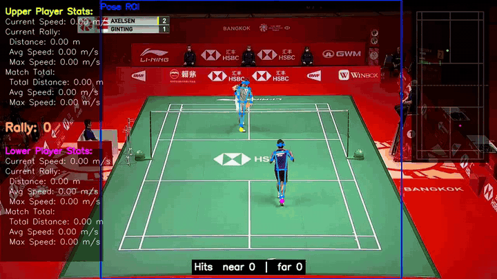
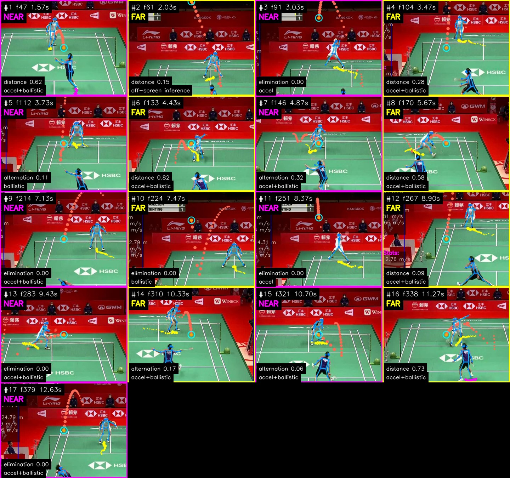
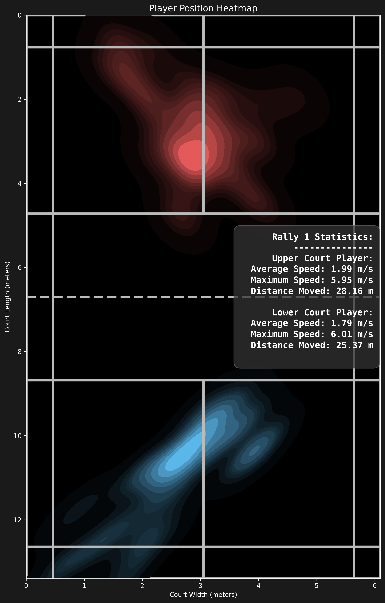
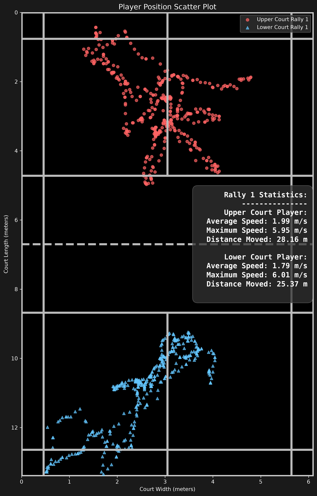
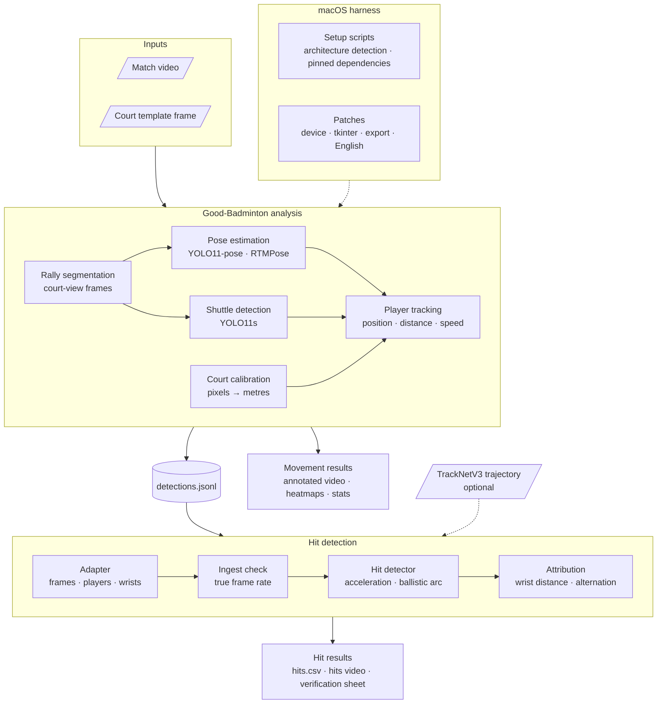

# Good-Badminton macOS Harness


macOS installers, compatibility patches and a hit-detection add-on for
[Good-Badminton](https://github.com/yo-WASSUP/Good-Badminton), an open-source
badminton video analysis pipeline (player pose, shuttle detection, court
mapping, movement statistics, position heatmaps).



*The sample clip bundled with Good-Badminton: skeletons, player trails and
movement statistics from Good-Badminton; each detected hit named with the
player it is credited to. More in [Demo](#demo).*

## Table of Contents

- [Demo](#demo)
- [Features](#features)
- [Architecture](#architecture)
- [Requirements](#requirements)
- [Installation](#installation)
- [Usage](#usage)
- [Output](#output)
- [Project Structure](#project-structure)
- [Implementation Details](#implementation-details)
- [Testing](#testing)
- [Validation](#validation)
- [Known Limitations](#known-limitations)
- [Troubleshooting](#troubleshooting)
- [Dependency Notes](#dependency-notes)
- [Acknowledgements](#acknowledgements)

## Demo

Output for the 14-second sample clip bundled with Good-Badminton.

| File | Contents |
|---|---|
| [`detect_demo_hits.mp4`](docs/demo/detect_demo_hits.mp4) | Full annotated video |
| [`hits_verify.jpg`](docs/demo/hits_verify.jpg) | One tile per detected hit at the moment of contact |
| [`hits.csv`](docs/demo/hits.csv) | Every hit with time, player and evidence |
| [`match_heatmap.png`](docs/demo/match_heatmap.png), [`match_scatter.png`](docs/demo/match_scatter.png) | Where each player stood |

### Detected hits



| # | Time | Player | Evidence | Detector |
|---|---|---|---|---|
| 1 | 1.57 s | near | distance 0.62 | accel+ballistic |
| 2 | 2.03 s | far | distance 0.15 | off-screen inference |
| 3 | 3.03 s | near | elimination 0.00 | accel |
| 4 | 3.47 s | far | distance 0.28 | accel+ballistic |
| 5 | 3.73 s | near | alternation 0.11 | ballistic |
| 6 | 4.43 s | far | distance 0.82 | accel+ballistic |

First 6 of 17; the full list is in [`hits.csv`](docs/demo/hits.csv).

### Player positions

<p align="center">
  
  
</p>

17 hits were reported. On frames 0–150, checked by hand, 4 of 6 real hits were
found, with 3 false detections, and 2 of 4 were credited to the right player.
See [Validation](#validation).

## Features

- **One-command setup** for Apple Silicon and Intel Macs, isolated in its own virtual environment.
- **Upstream patches** for macOS: optional tkinter, Metal/CPU device selection, no export timeout, English output.
- **Hit detection and attribution**: when each shot was played and by which player, using the badminton-ai stage 5 detector and attribution.
- **Padded frame-rate detection**: finds duplicated frames (e.g. 25 fps content in a 30 fps file) and detects on the real frames.
- **TrackNetV3 input**: optionally replace Good-Badminton's shuttle track with a TrackNetV3 trajectory.
- **Verification outputs**: a contact sheet of every hit and an annotated video.

## Architecture

The system takes a badminton match video and produces two kinds of results:
how each player moved (court position, distance, speed, heatmaps) and when
each shot was hit and by which player. It has three layers: a macOS harness
that installs and patches the upstream project, the Good-Badminton analysis
pipeline, and a hit-detection stage that runs on the pipeline's output.



| Layer | Component | Role | Technology |
|---|---|---|---|
| macOS harness | Setup scripts | Detect the CPU architecture, install pinned dependencies, download model weights | Bash, pip, lock file |
| macOS harness | Patches | Device selection, optional tkinter, no export timeout, English output | Python, reversible |
| Analysis | Rally segmentation | Keep frames that show the court | OpenCV template matching |
| Analysis | Pose estimation | Player skeletons and wrist positions | YOLO11-pose, RTMPose (ONNX Runtime) |
| Analysis | Shuttle detection | Shuttle position in each frame | YOLO11s (Ultralytics) |
| Analysis | Court calibration | Convert image pixels to court metres | OpenCV perspective transform |
| Analysis | Player tracking | Court position, distance and speed per player | NumPy |
| Hit detection | Adapter | Convert pipeline output: frame numbering, players, wrists, cuts | Python dataclasses |
| Hit detection | Ingest check | Detect padded video and recover the true frame rate | OpenCV frame differencing |
| Hit detection | Hit detector | Find strikes from abrupt acceleration and departures from a ballistic arc | NumPy |
| Hit detection | Attribution | Credit each strike to the player whose wrist is nearest, alternating within a rally | NumPy |
| Hit detection | Renderer | Verification sheet and annotated video | OpenCV, FFmpeg |

**Stack:** Python · PyTorch · Ultralytics YOLO11 · RTMPose · ONNX Runtime · OpenCV · NumPy · SciPy · FFmpeg · pytest

### Design principles

- **Upstream kept intact.** Changes to Good-Badminton are scripted patches with backups and a one-command revert.
- **Stages exchange typed data.** Each stage reads and writes plain dataclasses and is tested on its own.
- **Reproducible environments.** Separate dependency sets per CPU architecture; Intel installs from a lock file of tested versions.
- **Results checked by hand.** Outputs are compared frame by frame against the video, and results, including failures, are recorded under [Validation](#validation).

## Requirements

| | Apple Silicon | Intel |
|---|---|---|
| macOS | 12+ | 11+ (12+ recommended) |
| Python | 3.12 (arm64) | 3.10–3.12 (x86_64) |
| PyTorch | 2.5.1 | 2.2.2 |
| Acceleration | Metal (MPS) | CPU only |
| Setup script | `setup_mac.sh` | `setup_mac_intel.sh` |

Both need an internet connection. Homebrew, Xcode Command Line Tools and a
system ffmpeg are optional. Each setup script refuses
to run on the other architecture.

## Installation

Clone the repository and run every command from its root.

### Apple Silicon

```bash
bash setup_mac.sh
```

### Intel

Install Python 3.12.10 first if no 3.10–3.12 is present (3.12.10 is the last
3.12 release with a macOS installer):

```bash
curl -LO https://www.python.org/ftp/python/3.12.10/python-3.12.10-macos11.pkg
sudo installer -pkg python-3.12.10-macos11.pkg -target /
```

Then:

```bash
bash setup_mac_intel.sh
```

Setup clones Good-Badminton into `vendor/`, builds the virtual environment
(`.venv` or `.venv-intel`), downloads the model weights (~91 MB), links an
ffmpeg if none is installed, and applies the patches.

### Updating

```bash
git pull
```

`vendor/`, the virtual environment and all outputs are git-ignored and left
untouched.

## Usage

Activate the environment in every new terminal, from the repository root
(`.venv` on Apple Silicon):

```bash
source .venv-intel/bin/activate
cd vendor/Good-Badminton
```

### 1. Analyze a video

```bash
python main.py --video-path videos/demo.mp4 --template-path templates/demo.png \
    --pose-family yolo-pose --display false
```

A window shows the auto-detected court corners: **Enter** accepts, **M**
switches to clicking the four corners manually (top-left, top-right,
bottom-right, bottom-left). Corners are cached in the output directory.

For your own footage, extract a template frame that shows the whole court:

```bash
ffmpeg -ss 1 -i match.mp4 -frames:v 1 templates/match.png
```

| Pose model | Flags |
|---|---|
| YOLO11n-pose (default) | `--pose-family yolo-pose` |
| RTMPose-s | `--pose-family rtmpose --pose-mode balanced` |
| RTMO-s | `--pose-family rtmo --pose-mode lightweight` |

Other `--pose-mode` values require rtmlib to download models at runtime.

### 2. Detect hits

```bash
python ../../scripts/detect_hits.py outputs/demo
python ../../scripts/detect_hits.py outputs/match --tracknet path/to/match_ball.csv
```

| Option | Description |
|---|---|
| `--tracknet BALL_CSV` | Use a TrackNetV3 trajectory for the shuttle; Good-Badminton supplies wrists only. Recommended. |
| `--sensitivity S` | Below 1.0 finds more hits and more false positives. Default 1.0. |
| `--no-alternation` | Attribute by wrist distance only. |
| `--decimate {auto,off}` | Drop padded duplicate frames before detection. Default `auto`. |
| `--source VIDEO` | Source video for the padding check. Default: path in `metadata.json`. |
| `--video VIDEO` | Video to annotate. Default: the run's `detect_<name>.mp4`. |
| `--no-video`, `--no-montage` | Skip the annotated video or the contact sheet. |

### 3. Inspect a run

```bash
python ../../scripts/compare_runs.py outputs/demo/detections.jsonl
python ../../scripts/compare_runs.py outputs/match/detections.jsonl --tracknet path/to/match_ball.csv
python ../../scripts/compare_runs.py outputs/match/detections.jsonl --frames 60-66
```

Prints frame coverage, player detection, shuttle gaps and, with `--tracknet`,
agreement with a TrackNetV3 trajectory. All frame numbers are 0-based.

### Web UI

```bash
pip install "gradio>=4.0.0"
python -m webui.app
```

## Output

Written to `vendor/Good-Badminton/outputs/<name>/`.

| File | Source | Contents |
|---|---|---|
| `detect_<name>.mp4` | Good-Badminton | Annotated video: skeletons, trails, mini-court, player stats |
| `detections.jsonl` | Good-Badminton | Per frame: player court position (m), speed, wrists, shuttle pixel position |
| `position_visualizations/` | Good-Badminton | Heatmaps and scatter plots per rally and per match |
| `metadata.json`, `court_annotations.txt` | Good-Badminton | Video info and cached court corners |
| `hits.json` | `detect_hits.py` | Events, rejected candidates, trajectory statistics, settings |
| `hits.csv` | `detect_hits.py` | One row per hit: frame, contact frame, time, player, attribution method and score |
| `hits_verify.jpg` | `detect_hits.py` | One tile per hit at contact |
| `detect_<name>_hits.mp4` | `detect_hits.py` | Annotated video with each hit named and a running tally |

Frame numbers in `hits.*` are 0-based. Player 0 is near (Good-Badminton
`lower`), player 1 is far (`upper`).

## Project Structure

```
.
├── setup_mac.sh               Apple Silicon setup
├── setup_mac_intel.sh         Intel setup
├── requirements-mac.txt
├── requirements-intel.txt
├── requirements-intel.lock    Exact versions tested on Intel
├── scripts/
│   ├── fetch_weights.sh       Model weights from the v0.1.0 release
│   ├── patch_for_mac.py       Upstream patches (--check, --revert)
│   ├── detect_hits.py         Hit detection CLI
│   └── compare_runs.py        Run summary and TrackNetV3 comparison
├── hits/
│   ├── badminton_ai/          badminton-ai stage 5 and attribution
│   ├── adapter.py             Good-Badminton output → stage 5 inputs
│   └── render.py              Contact sheet and annotated video
├── tests/
├── docs/demo/                 Sample outputs shown in this README
└── vendor/Good-Badminton/     Created by setup, git-ignored
```

## Implementation Details

### Patches

`scripts/patch_for_mac.py` edits the cloned upstream code. It is idempotent,
writes `.orig` backups and is reverted with `--revert`.

| Patch | Reason |
|---|---|
| tkinter imported lazily | Homebrew Python ships without tkinter; upstream crashes on import, even for `--help`. |
| Device selection | Upstream only checks CUDA. Apple Silicon uses MPS; Intel uses CPU. Override with `GB_DEVICE=cpu\|mps\|cuda`. |
| No ffmpeg export timeout | A 180 s limit discards the final video on slow CPUs. |
| English output | Console output, `--help` and the web UI default to Chinese. |

### Hit detection

1. **Load** `detections.jsonl`: frames converted to 0-based, `lower`/`upper` mapped to near/far, wrists (COCO keypoints 9/10) assigned confidence 1.0, frames skipped by Good-Badminton treated as camera cuts.
2. **Ingest check**: frames that repeat their predecessor at a regular period are dropped and detection runs at the true frame rate.
3. **Detect**: badminton-ai stage 5 (acceleration peaks + ballistic divergence, with rejection rules for serve release, floor landing, frozen tracker and cuts, and off-screen inference).
4. **Attribute**: wrist distance with a 3-frame lookback, constrained to alternate between players within a rally.
5. **Map back** to original frame numbers and render.

## Testing

```bash
pip install pytest
python -m pytest
```

36 tests: 28 for stage 5 and attribution and 8 for the adapter,
covering frame numbering, player mapping, cuts, padded-frame detection,
decimation round-trip and TrackNetV3 substitution.

## Validation

### Installation

| Platform | Result |
|---|---|
| Intel, 2020 MacBook Air (i7-1060NG7, macOS 15.7.4, Python 3.12.10) | Full demo run; 426/426 frames analysed, shuttle in 407 (96%); 303 s for the 14.2 s clip (21× real time); hit detection identical to the Linux run (17 of 17 events) |
| x86_64 Linux, Python 3.12 | Full demo run with both pose families; setup script in a simulated macOS environment |
| Apple Silicon | Dependency resolution only |

### Hit detection on the demo clip

The bundled demo is 25 fps content in a 30 fps file; the ingest check removes
69 duplicated frames. With Good-Badminton's shuttle track, 17 hits are
reported. Frames 0–150 were checked by hand:

| | Result |
|---|---|
| Hits found | 4 of 6 |
| False positives | 3 |
| Correct player | 2 of 4 |

Causes: Good-Badminton's ball detector tracks the far player's white clothing
for ~20 frames; the off-screen rule fires on a high lift (speed ratio 1.87
against a 2.0 threshold); one error then propagates through the alternation
chain. Use `--tracknet` and validate on clips with a hand-labelled answer key.

## Known Limitations

- Singles only.
- Low serves are not detected.
- Camera cuts are only those Good-Badminton skips as non-court frames.
- Good-Badminton writes wrists without confidence, so spurious wrists count as evidence.
- Good-Badminton identifies players by court half (`upper`/`lower`); identity does not survive an end change.
- Good-Badminton's rally number is drawn on the video but not written to `detections.jsonl`.
- Court mapping uses four corners with no outlier rejection and assumes a 6.1 × 13.4 m doubles court.

## Troubleshooting

| Symptom | Fix |
|---|---|
| `No usable Python found` | Install Python 3.12.10 (see [Intel](#intel)). |
| `zsh: command not found: python` | Activate the virtual environment. |
| `Error checking audio track: … 'ffprobe'` | Harmless; the video is still exported. |
| Court window does not appear | Check behind other windows, or use the [web UI](#web-ui). |
| `Ingest check skipped: source video not found` | Run from `vendor/Good-Badminton` or pass `--source`. |
| `… consecutive positions are identical` warning | The video is padded and the ingest check did not run; pass `--source`. |
| Pose model download stalls | Use a pose family/mode pair listed in [Usage](#1-analyze-a-video). |
| Patch reports `expected code block not found` | Upstream changed; review the named file manually. |

## Dependency Notes

- Upstream pins `torch==2.5.1+cpu`; the `+cpu` build does not exist for macOS. The Apple Silicon requirements use `torch==2.5.1`.
- PyTorch 2.2.2 is the last release with Intel macOS wheels; torchvision is pinned to the matching 0.17.2.
- PyTorch 2.2.2 requires NumPy 1.x.
- OpenCV 4.10's Intel wheel requires macOS 12; on macOS 11 the setup script substitutes 4.9.0.80.
- `requirements-intel.lock` pins every package to the versions that were tested and is applied with `pip install -c`.
- ffmpeg is linked from `imageio-ffmpeg` (static build with libx264, macOS 11+).

## Acknowledgements

| Component | License |
|---|---|
| [Good-Badminton](https://github.com/yo-WASSUP/Good-Badminton) | Apache-2.0 |
| [RTMPose / rtmlib](https://github.com/Tau-J/rtmlib) | Apache-2.0 |
| [Ultralytics YOLO](https://github.com/ultralytics/ultralytics) | AGPL-3.0 |
| [TrackNetV3](https://github.com/qaz812345/TrackNetV3) | MIT |
| [imageio-ffmpeg](https://github.com/imageio/imageio-ffmpeg) bundled ffmpeg | GPL |

The demo footage is the sample clip distributed with Good-Badminton.

`hits/badminton_ai/` is inspired by the stage 5 shot detection and attribution
in badminton-ai, and `tests/synth.py`, `tests/test_detect_shots.py` and
`tests/test_attribute.py` by its test suite.
